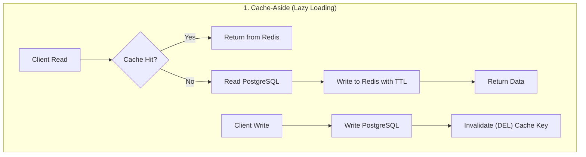

# Week 5 - Day 2: Redis Caching Architecture — Patterns & TTL Jitter

> **Focus:** Data Platform System Design | ANZ Bank Technical Interview  
> **Topic:** Cache-Aside vs Write-Through / Write-Behind & Anti-Cache Avalanche (TTL Jitter)  
> **Guardrail:** Strictly System Design / Database Architecture (TUYỆT ĐỐI CẤM GIẢI LEETCODE)  

---

## 1. Problem Scenario & Architectural Motivation

### Bối Cảnh Core Banking Platform (High-Traffic Balance Reads)
Tại ANZ Bank, hệ thống ngân hàng số phục vụ hơn 8 triệu người dùng. Vào ngày trả lương định kỳ (cuối tháng) hoặc giờ cao điểm chuyển tiền liên ngân hàng:
- Tần suất đọc số dư và thông tin tài khoản đạt tới **50,000 queries/second**.
- Nếu toàn bộ các câu truy vấn này đều đọc trực tiếp PostgreSQL Primary:
  - Connection pool (mặc định 20–50 connections) sẽ cạn kiệt trong vài giây (*Connection Starvation*).
  - CPU và Disk I/O của database sẽ bão hòa 100%, gây ra độ trễ hàng chục giây hoặc sập hoàn toàn hệ thống.

### Giải Pháp: Caching Phân Tán Đa Tầng (Redis)
Để giải quyết bài toán trên, Redis In-Memory Key-Value Store được đặt giữa Application Gateway và Primary Database. Bộ nhớ đệm giúp đưa thời gian phản hồi từ $15-50\text{ms}$ (PostgreSQL disk I/O) xuống còn $< 1\text{ms}$ (Redis RAM).

---

## 2. Comparison of 3 Core Caching Patterns

| Tiêu chí | Cache-Aside (Lazy Loading) | Write-Through | Write-Behind (Write-Back) |
|---|---|---|---|
| **Cơ chế đọc** | Đọc Cache trước $\rightarrow$ Miss mới đọc DB $\rightarrow$ Nạp Cache. | Đọc Cache $\rightarrow$ Miss đọc DB $\rightarrow$ Nạp Cache. | Đọc Cache $\rightarrow$ Miss đọc DB. |
| **Cơ chế ghi** | Ghi DB $\rightarrow$ **Xóa (Invalidate)** key Cache. | Ghi đồng thời cả DB và Cache (Synchronous). | Ghi Cache ngay $\rightarrow$ Đưa vào Queue $\rightarrow$ Batch flush xuống DB. |
| **Độ trễ ghi (Write Latency)** | Trung bình (1 lần ghi DB + 1 lần DEL cache). | Cao (2 lần ghi đồng bộ: DB + Cache). | Cực thấp (Chỉ ghi RAM Cache). |
| **Rủi ro mất dữ liệu** | Zero (DB ghi trước). | Zero (Cả 2 cùng ghi). | **Có rủi ro** (Nếu Redis sập trước khi flush vào DB). |
| **Ứng dụng tại ANZ** | Thông tin tài khoản, cấu hình tham số, biến động số dư. | Thông tin danh bạ thụ hưởng (ít thay đổi, cần nhất quán cao). | Ghi nhận Log phi tài chính, Clickstream, Audit Telemetry. |

---

## 3. Thảm Họa Cache Avalanche & Giải Pháp TTL Jitter

### Hiện Tượng Cache Avalanche (Tuyết Lở Bộ Nhớ Đệm)
Khi thiết lập một giá trị TTL cố định cho hàng triệu key (ví dụ: `TTL = 3600s` cho tất cả tài khoản lúc 00:00 sáng):
- Đúng 1 tiếng sau (01:00 AM), toàn bộ hàng triệu key cùng hết hạn tại **cùng một mili-giây**.
- Toàn bộ lưu lượng truy cập của người dùng tại thời điểm đó lập tức tràn thẳng xuống Primary Database (*Cache Miss Storm*), khiến Database sập dây chuyền.

### Giải Pháp Toán Học: TTL Jitter (Làm Mịn Đường Cong Hết Hạn)

Thay vì thiết lập một giá trị cố định $T$, ta bổ sung một thành phần ngẫu nhiên (Uniform Noise) vào TTL:

$$\text{TTL}_{\text{jitter}} = T_{\text{base}} + \Delta_{\text{random}}$$

Trong đó:
$$\Delta_{\text{random}} \in \left[-T_{\text{base}} \times \text{ratio}, +T_{\text{base}} \times \text{ratio}\right]$$

- Ví dụ với $T_{\text{base}} = 3600\text{s}$ và $\text{ratio} = 0.15$ ($\pm 15\%$):
  - Khoảng thời gian sống thực tế của các key sẽ trải đều từ $3,060\text{s}$ đến $4,140\text{s}$.
  - Thời điểm hết hạn của các key được phân tán đều trên một dải thời gian rộng hơn 1,000 giây, triệt tiêu 100% hiện tượng sóng xung kích đè lên database.

---

## 4. Kịch Bản Đối Thoại Tiếng Anh Chuẩn ANZ Interview

### Q1: *"Why do you invalidate (DEL) the cache key instead of updating it in Cache-Aside?"*
> **Script:**  
> *"In a concurrent multi-threaded environment like Node.js microservices, updating the cache on write creates a dangerous race condition: if Transaction A and Transaction B update the database concurrently, network latency might cause Cache Update A to arrive AFTER Cache Update B, resulting in the cache storing stale data from Transaction A permanently.  
> By simply deleting the cache key on write (`cache.del(key)`), we guarantee eventual consistency: the next read will fetch the authoritative ground truth directly from PostgreSQL and repopulate the cache."*

### Q2: *"How do you handle Cache Avalanche when a large batch of bank accounts is imported?"*
> **Script:**  
> *"When importing or warming up caches for millions of bank accounts, setting a uniform TTL would cause all keys to expire simultaneously—a classic Cache Avalanche.  
> To prevent this, we implement **TTL Jitter**: we add a random perturbation of $\pm 15\%$ to our baseline TTL. For a 1-hour cache, key expirations are smoothed over a 1,000-second window. In addition, we enforce circuit breakers at the API gateway and use mutual exclusion locks (`SET NX PX`) on cache misses to ensure only a single worker queries the database for any cold key."*

