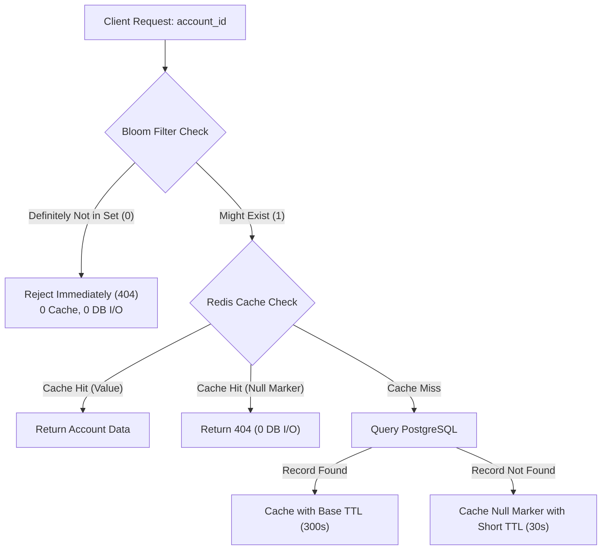

# Week 5 - Day 4: Cache Penetration (Bloom Filter) & Distributed Lock (SET NX PX)

> **Focus:** Data Platform System Design | ANZ Bank Technical Interview  
> **Topic 1:** Cache Penetration Defense (Null Object vs Bloom Filter)  
> **Topic 2:** Distributed Lock Architecture (`SET NX PX` & Atomic Lua Release)  
> **Target System:** Core Banking Payment Ledger & Anti-Overdraft Protection  
> **Guardrail:** Strictly System Design / Database Architecture (TUYỆT ĐỐI CẤM GIẢI LEETCODE)  

---

## 1. Problem Scenario 1: Cache Penetration (Xuyên Thủng Bộ Nhớ Đệm)

### Hiện Tượng & Nguy Cơ Sập Hệ Thống
Một kẻ tấn công (hoặc lỗi logic client) liên tục gửi hàng triệu yêu cầu truy vấn thông tin tài khoản với các ID hoàn toàn không tồn tại (ví dụ: `account_id = -999999` hoặc `UUID` rác):
1. **Application** tra cứu Redis Cache $\rightarrow$ **Cache Miss** (vì ID không tồn tại).
2. **Application** tiếp tục truy vấn PostgreSQL Primary $\rightarrow$ **DB Miss** (trả về `null`).
3. Vì giá trị trả về là `null`, Application mặc định **không lưu vào Cache**.
4. Hậu quả: Mọi request tiếp theo với cùng ID rác đó đều xuyên thủng lớp đệm Cache và đập thẳng vào PostgreSQL, gây sập database (*Cache Penetration Denial of Service*).

### Hai Cơ Chế Phòng Thủ (Two Lines of Defense)



1. **Defense A: Null Object Caching (Phòng ngự tầng Cache)**:
   - Khi DB trả về `null`, ta vẫn lưu một bản ghi rỗng `{ isNull: true }` vào Redis với **TTL ngắn** (ví dụ: 30–60 giây).
   - Các truy vấn tiếp theo trong vòng 30s sẽ đọc trúng bản ghi rỗng trong Cache, bảo vệ hoàn toàn DB.
2. **Defense B: Bloom Filter (Phòng ngự tầng Gateway / Pre-Filter)**:
   - Dùng mảng bit nhỏ gọn (vài megabytes cho hàng chục triệu khách hàng) với 3 hàm băm độc lập (DJB2, FNV-1a, SDBM).
   - Invariant: **Không bao giờ có False Negative** (Nếu Bloom Filter nói "KHÔNG CÓ", chắc chắn ID đó 100% không tồn tại trong ngân hàng).
   - Chặn đứng 99.9% lưu lượng rác ngay tại Gateway trước khi request chạm vào Redis hay PostgreSQL.

---

## 2. Problem Scenario 2: Race Condition & Distributed Lock (`SET NX PX`)

### Bối Cảnh Rút Tiền Đồng Thời (Concurrent Double Spending)
Giả sử tài khoản khách hàng còn đúng **$1,000**.
Khách hàng thực hiện đồng thời 2 lệnh rút tiền **$1,000** trên 2 kênh khác nhau (Mobile Banking và ATM):
- Request 1 đến Server Node 1: Đọc số dư = $1,000 $\rightarrow$ Đủ tiền.
- Request 2 đến Server Node 2: Đọc số dư = $1,000 $\rightarrow$ Đủ tiền.
- Cả 2 server cùng trừ tiền $\rightarrow$ Khách hàng rút được $2,000$, ngân hàng bị thấu chi âm $1,000$ (*Double Spending Anomaly*).
- Khóa nội bộ Node.js (in-memory mutex) vô tác dụng vì các server nằm trên các container/pod Kubernetes khác nhau.

### Giải Pháp: Distributed Lock Bằng Redis `SET NX PX`

1. **Acquire Lock**:
   - Dùng lệnh nguyên tử: `SET lock:acc:<id> <unique_owner_id> NX PX 5000`.
   - `NX`: Chỉ tạo key nếu key CHƯA tồn tại (Mutual Exclusion).
   - `PX 5000`: Tự động giải phóng sau 5,000ms nếu worker bị crash (Anti-Deadlock).
2. **Release Lock Nguyên Tử (Atomic Release via Lua Script)**:
   - Không được dùng `DEL lock:acc:<id>` thông thường!
   - Kịch bản lỗi: Nếu Worker 1 bị nghẽn GC quá 5s, lock tự hết hạn và Worker 2 lấy được lock. Sau đó Worker 1 hồi tỉnh và gọi `DEL`, nó sẽ **xóa nhầm lock của Worker 2**!
   - Giải pháp bắt buộc: Dùng Lua script kiểm tra `ownerId`:
   ```lua
   if redis.call("get", KEYS[1]) == ARGV[1] then
       return redis.call("del", KEYS[1])
   else
       return 0
   end
   ```

---

## 3. Kịch Bản Đối Thoại Tiếng Anh Chuẩn ANZ Interview

### Q1: *"How do you differentiate Cache Penetration, Cache Breakdown, and Cache Avalanche?"*
> **Script:**  
> *"In distributed systems, these are three distinct failure modes with different solutions:*
> - *1. **Cache Penetration**: Queries request keys that DO NOT exist in either Cache or Database (malicious attacks). Solution: Bloom Filter and Null Object Caching.*
> - *2. **Cache Breakdown (Hotspot Invalidated)**: A single extremely hot key expires, causing thousands of concurrent requests to stampede the DB simultaneously. Solution: Mutex Lock (`SET NX PX`) on cache miss or logical expiration (background refresh).*
> - *3. **Cache Avalanche**: A vast volume of diverse keys expire at the exact same moment. Solution: TTL Jitter to smooth expiration distributions, combined with cluster HA."*

### Q2: *"Why is releasing a distributed lock in Redis dangerous without verifying ownership?"*
> **Script:**  
> *"If Worker A acquires a 5-second lock but experiences a long V8 Garbage Collection pause of 6 seconds, the lock automatically expires in Redis. Worker B then legitimately acquires the lock on the same resource.*  
> *When Worker A finishes its paused execution, if it blindly executes `DEL lock:key`, it inadvertently deletes Worker B's lock! Worker C could then acquire the lock, violating mutual exclusion and corrupting bank ledgers.*  
> *To prevent this, every lock acquisition includes a unique UUID (`ownerId`). When releasing, we execute an atomic Lua script that compares the stored UUID with our caller's UUID before deleting. If they don't match, deletion is aborted."*

