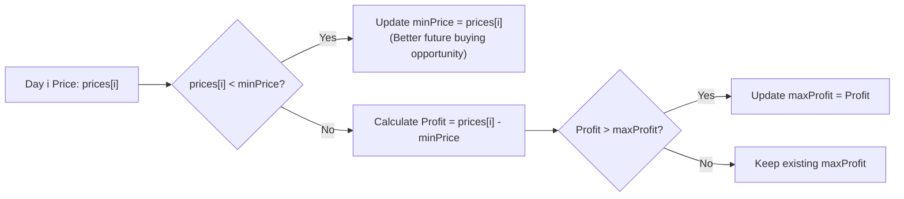

# Week 5 - Day 1: Best Time to Buy and Sell Stock (LeetCode #121 - Easy)

> **Focus:** HCLTech x ANZ Bank Technical Interview Prep  
> **Topic:** Single-Pass Greedy / Prefix Minimum Tracking  
> **Target Complexity:** $O(n)$ Time, $O(1)$ Auxiliary Space  
> **Classification:** Early-Week Gate (Khởi động tuần nhẹ nhàng — Tuần 0-Medium)  

---

## 1. Problem Scenario & Pain Point

### Bối Cảnh Nghiệp Vụ Ngân Hàng (Financial Market Tick Data)
Tại ANZ Global Markets, hệ thống ngoại hối và chứng khoán xử lý hàng triệu bản ghi giá (price ticks) theo chuỗi thời gian. Một nhà đầu tư muốn tối đa hóa lợi nhuận bằng việc thực hiện duy nhất **1 lệnh mua** và **1 lệnh bán** trong phiên giao dịch.

### Điểm Nghẽn Của Brute-Force $O(n^2)$
Một giải pháp ngây thơ (Brute-force) sẽ dùng 2 vòng lặp lồng nhau: với mỗi ngày $i$ (mua), duyệt qua tất cả các ngày $j > i$ (bán) để tìm `Math.max(prices[j] - prices[i])`.
- Với $n = 50,000$ mức giá, số phép so sánh là $\frac{n(n-1)}{2} \approx 1.25 \times 10^9$ phép tính, gây đóng băng V8 Event Loop và timeout trên HackerRank.

### Giải Pháp Tối Ưu: Theo Dõi Đáy Cục Bộ (Prefix Minimum Tracking)
- Lợi nhuận bán vào ngày $i$ luôn bằng: $\text{Profit}_i = \text{prices}[i] - \min_{0 \le k < i}(\text{prices}[k])$.
- Vì vậy, ta chỉ cần duy trì biến `minPrice` lưu mức giá thấp nhất nhìn thấy từ đầu đến ngày hiện tại.
- Thuật toán chỉ cần duyệt qua mảng đúng 1 lần ($O(n)$), sử dụng $O(1)$ bộ nhớ phụ.

---

## 2. Structured 6-Step English Communication Script

### Step 1: Clarify
> *"Before starting, let me clarify the constraints and edge cases:*
> - *Is the price array always non-negative? Yes, stock prices cannot be negative.*
> - *Can we buy and sell on the same day? The problem states we must sell on a different day in the future, so at least two days are required to make a profit.*
> - *What should we return if prices strictly decrease or if the array has fewer than 2 elements? If no profit is possible, we should return 0.*
> - *Can we execute multiple transactions? No, exactly one buy and one sell transaction."*

### Step 2: Brute-Force
> *"A brute-force approach would examine all possible pairs $(i, j)$ where $j > i$, calculating `prices[j] - prices[i]`. That would take $O(n^2)$ time with two nested loops. With 50,000 prices, that yields over 1 billion operations, which would exceed our latency budget and trigger time-limit exceeded errors."*

### Step 3: Optimize
> *"To optimize this to $O(n)$ time and $O(1)$ space, we recognize the core invariant: if we choose to sell on day $i$, we would always have preferred to buy at the lowest price encountered prior to day $i$.*  
> *Therefore, we can iterate through the array once while maintaining two variables: `minPrice` initialized to `prices[0]`, and `maxProfit` initialized to `0`. For each price, if it is lower than `minPrice`, we update `minPrice`. Otherwise, we calculate the potential profit and update `maxProfit` if it exceeds our current best."*

### Step 4: Think Out Loud
> *"I'll write a guard clause at Line 1: `if (!Array.isArray(prices) || prices.length < 2) return 0;`.*  
> *Next, I'll initialize `minPrice = prices[0]` and `maxProfit = 0`.*  
> *Then, I loop from index 1 to the end of the array. At each iteration, if `prices[i] < minPrice`, I record `minPrice = prices[i]`. Otherwise, I calculate `currentProfit = prices[i] - minPrice`, and if it's greater than `maxProfit`, I update `maxProfit`.*  
> *Finally, I return `maxProfit`."*

### Step 5: Dry Run
> *"Let's trace with example `prices = [7, 1, 5, 3, 6, 4]`.*
> - *Init: `minPrice = 7`, `maxProfit = 0`.*
> - *Day 1 (`price = 1`): `1 < 7`, so `minPrice = 1`.*
> - *Day 2 (`price = 5`): `5 >= 1`, profit = $5 - 1 = 4 > 0$, so `maxProfit = 4`.*
> - *Day 3 (`price = 3`): `3 >= 1`, profit = $3 - 1 = 2 < 4$, `maxProfit` remains 4.*
> - *Day 4 (`price = 6`): `6 >= 1`, profit = $6 - 1 = 5 > 4$, so `maxProfit = 5`.*
> - *Day 5 (`price = 4`): `4 >= 1`, profit = $4 - 1 = 3 < 5$, `maxProfit` remains 5.*
> - *Loop terminates and returns 5. The dry run confirms exact correctness."*

### Step 6: Conclusion
> *"In conclusion:*
> - *Time Complexity: $O(n)$ because we iterate through the array in a single pass.*
> - *Space Complexity: $O(1)$ auxiliary memory since we only maintain two primitive number variables.*
> - *This approach is strictly optimal and respects the temporal constraint that buying must precede selling."*

---

## 3. Pattern Synthesis & Banking Invariant

> **Key Takeaway for ANZ Interviews**:
> Khi một bài toán đòi hỏi tìm hiệu số cực đại $A[j] - A[i]$ với ràng buộc thứ tự $j > i$, luôn duy trì một biến theo dõi **giá trị nhỏ nhất từ trước đến nay** (Prefix Minimum). Kỹ thuật này giảm độ phức tạp từ $O(n^2)$ về $O(n)$ với $O(1)$ bộ nhớ.

