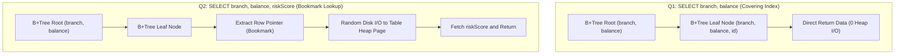

# Week 5 - Day 3: Mid-Phase Recall & Consolidation Day

> **Focus:** Spaced Repetition Discipline & Anti-Burnout Protocol  
> **Recall 1:** Longest Substring Without Repeating Characters (LeetCode #3 - Sliding Window)  
> **Recall 2:** B+Tree Index Bookmark Lookup vs Covering Index Scan (Architecture Deep Dive)  
> **Guideline:** Không học bài LeetCode mới để dành trọn tải nhận thức cho Redis & Distributed Systems  

---

## 1. Nhật Ký Spaced Repetition (Mid-Phase Recall Log)

- **Ngày thực hiện:** `2026-10-14` (Thứ 4, Phiên sáng 05:00 - 06:00 AM)
- **Hình thức:** Gõ lại hoàn toàn từ trí nhớ trên màn hình trắng (không xem code mẫu).
- **Kết quả:** `PASS in 12m` (Đạt chuẩn $< 15$ phút).
- **Header xác thực:** `// Mid-Phase Recall: [2026-10-14] - PASS in 12m`.

### Tóm Tắt Trực Giác Cốt Lõi (Core Invariants)
1. **Bẫy lùi con trỏ trái (`abba` Trap)**:
   - Khi ký tự lặp lại xuất hiện, chỉ số lưu trong Map có thể nhỏ hơn vị trí hiện tại của `left` (do các ký tự khác ở giữa đã đẩy `left` lên).
   - Invariant: Con trỏ trái **TUYỆT ĐỐI KHÔNG ĐƯỢC LÙI LẠI**: `left = Math.max(left, lastSeenMap.get(char) + 1)`.
2. **Độ phức tạp**: $O(n)$ time (mỗi ký tự được duyệt bởi con trỏ `right` đúng 1 lần), $O(\min(m, n))$ auxiliary space.

---

## 2. Tái Hiện Kiến Trúc B+Tree Index (Systems Recall)

### Điểm Khác Biệt Sống Còn Trong Phỏng Vấn ANZ
- **Covering Index (Index-Only Scan)**: Toàn bộ các cột trong mệnh đề `SELECT` đều nằm trong Composite Index. Database chỉ cần đọc các trang lá (Leaf pages) của B+Tree, hoàn toàn **0 tốn I/O đọc Table Heap**.
- **Bookmark Lookup**: Nếu câu truy vấn cần thêm dù chỉ 1 cột không có trong Index (như `riskScore`), Database buộc phải dùng con trỏ dòng (Row ID/Bookmark) để nhảy vào các Data Pages của Table Heap. Khi có hàng triệu dòng thỏa mãn điều kiện, hàng triệu lần Random I/O sẽ làm tê liệt Disk Controller.

